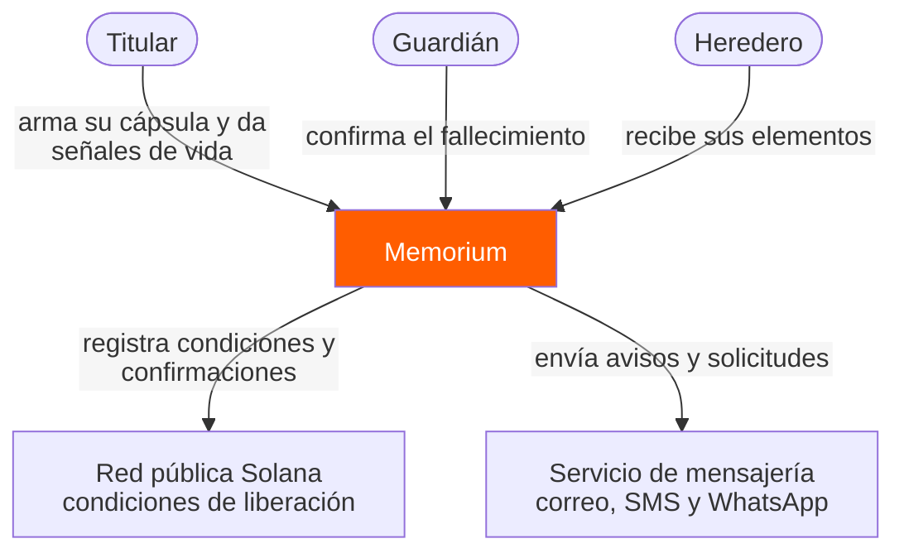
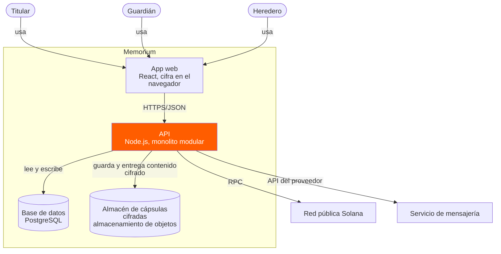
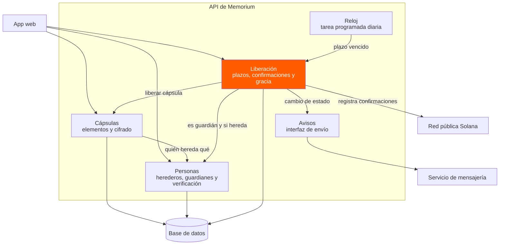
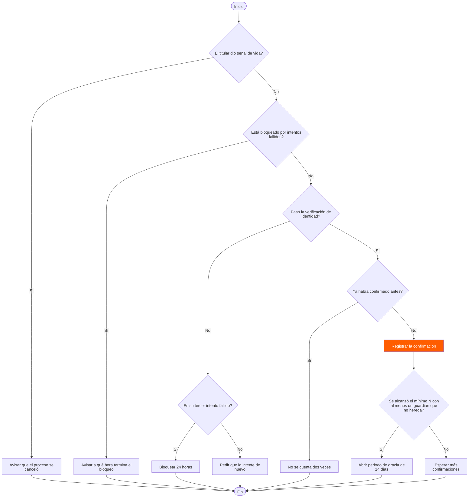
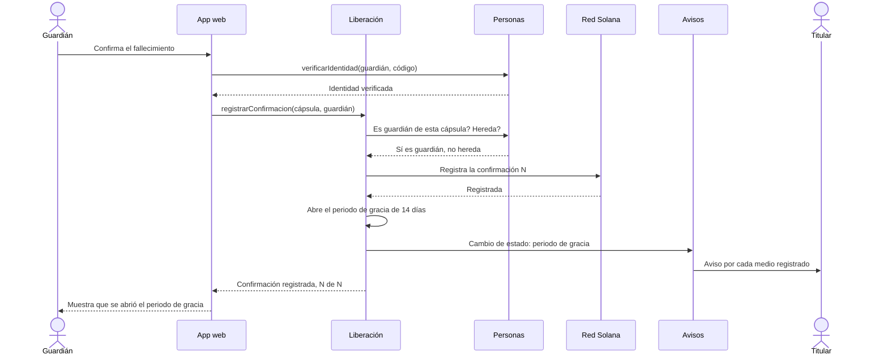
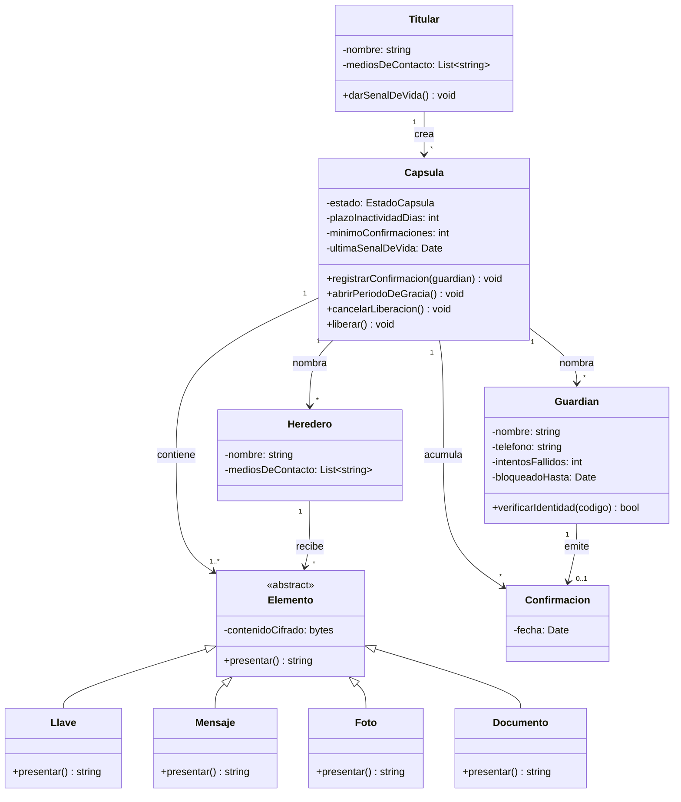
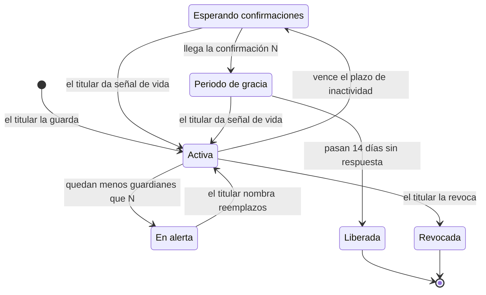
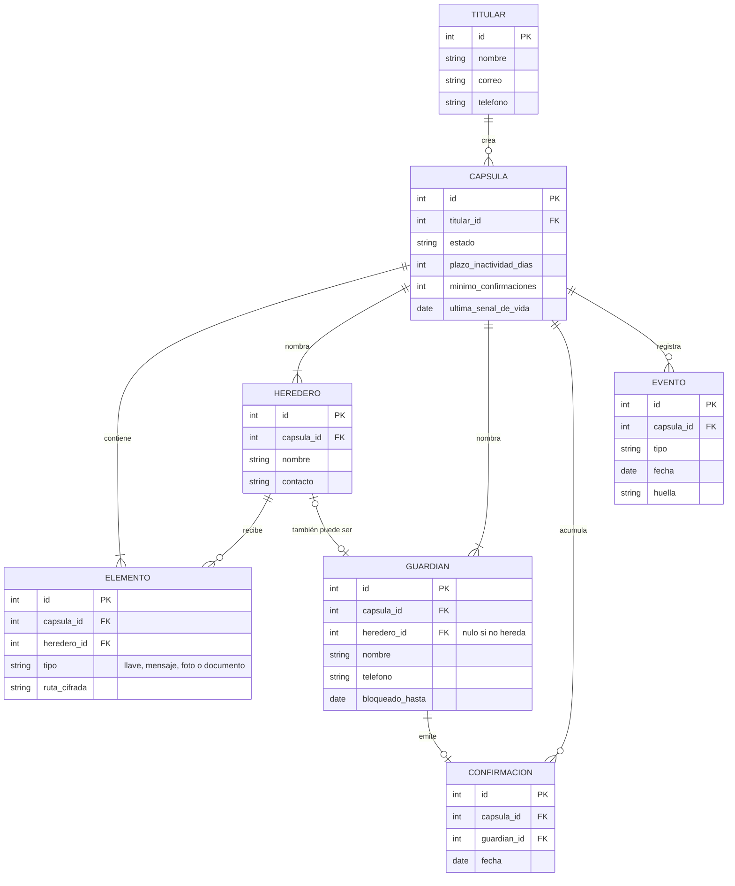

# Diagramas de arquitectura · Memorium

Ingeniería de Software I (SIS3407) · Unidad 3, diseño de software
Autor: Emiliano Cabañas Prieto

Los diagramas están escritos en Mermaid, así que GitHub los dibuja directamente en esta página y cualquier cambio queda visible en el historial del repositorio. Los tres primeros siguen los niveles 1 a 3 del modelo C4. Los otros cinco usan el mismo sistema para mostrar un flujo, una secuencia, las clases, los estados de la cápsula y las tablas.

## Decisión de arquitectura que siguen los diagramas

Memorium es un monolito modular con cuatro módulos: Cápsulas, Personas, Liberación y Avisos. La regla que se ve en los diagramas es que un módulo no lee las tablas de otro: si necesita un dato ajeno, se lo pregunta al módulo dueño por su interfaz. El porqué de la decisión está en [ADR-001 · Monolito modular](adr-001-monolito-modular.md).

---

## 1. Nivel 1 · Diagrama de contexto

Quién usa Memorium y con qué sistemas externos habla. No aparece ninguna tecnología.

La red pública guarda las condiciones de liberación porque ahí no las puede alterar ni el propio operador de Memorium (RNF-SEG-002).

## 2. Nivel 2 · Diagrama de contenedores

Las piezas que se despliegan por separado. El `subgraph` marca la frontera: lo de adentro es Memorium, lo de afuera no.

El contenido se cifra en el navegador antes de subirlo, así que el almacén solo guarda datos ilegibles (RNF-SEG-001). Son cuatro contenedores porque son las cuatro piezas que se despliegan por separado. El reloj que revisa los plazos no aparece aquí: corre dentro de la API, así que es un componente y está un nivel más adentro.

## 3. Nivel 3 · Diagrama de componentes

Lo que hay dentro de la API. Liberación es el módulo central, por eso va resaltado.

Tres detalles. El Reloj es el actor "Tiempo" de los casos de uso: cada día revisa qué plazos vencieron y se lo avisa a Liberación. Liberación le pregunta a Personas si alguien es guardián y si hereda, en lugar de leer sus tablas, que es la regla del ADR-001. Y Avisos está puesto como interfaz y no como un proveedor concreto: es el patrón Adapter, y además recibe los cambios de estado que anuncia Liberación, que es el patrón Observer.

---

## 4. Diagrama de flujo con decisiones

Qué pasa cuando un guardián intenta confirmar el fallecimiento (CU-05).

Cada rombo sale de un requisito: RF-012 (señal de vida), RF-023 (bloqueo de 24 horas), RF-022 (verificación), RF-009 (no contar dos veces) y RF-005 con RF-010 (mínimo con un guardián que no hereda).

## 5. Diagrama de secuencia

La confirmación que completa el mínimo y abre el periodo de gracia, de punta a punta.

Las flechas sólidas son llamadas y las punteadas son respuestas. Liberación no decide sola si alguien es guardián: se lo pregunta a Personas.

## 6. Diagrama de clases

Las clases del dominio. Elemento es abstracta y cada tipo sabe presentarse solo, que es el patrón Strategy que se identificó en la actividad anterior.

El menos es privado y el más es público. `1..*` en Elemento refleja RF-001: una cápsula no se guarda sin al menos un elemento. `0..1` en Confirmación refleja RF-009: cada guardián cuenta una sola vez.

## 7. Diagrama de estados

El ciclo de vida de una cápsula y el evento que la mueve de un estado a otro.

Los nombres de los estados son los mismos de los criterios de aceptación (RF-010, RF-012, RF-015 y RF-017). Liberada y Revocada son finales: de ahí no se regresa, que es justo por lo que RNF-SEG-003 exige cero liberaciones indebidas.

## 8. Diagrama entidad-relación

Las tablas de la base de datos y cómo se relacionan.

`heredero_id` en GUARDIAN es lo que permite revisar RF-005: si es nulo, ese guardián no hereda nada. La columna `huella` de EVENTO encadena cada evento con el anterior para que una alteración quede en evidencia (RNF-SEG-004).
